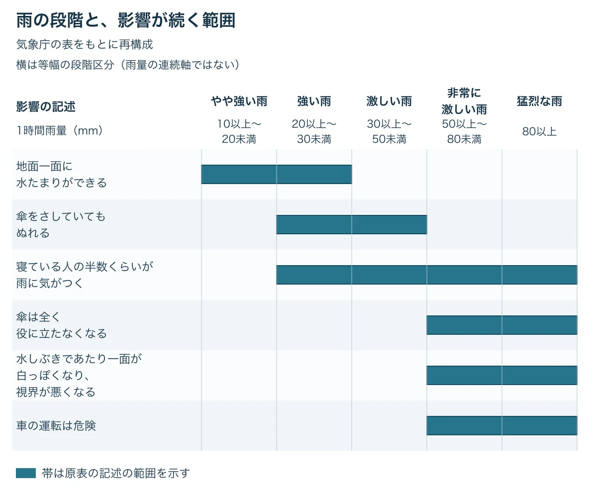

# その雨は、何段階で降るか――気象庁の「雨の強さと降り方」から、雨の効き目を決める

雨が降りはじめた。小雨のうちは、そのまま探索を続けられる。どしゃ降りになると、遠くの目印が見えにくくなる。プレイヤーは移動をやめて雨宿りするか、それとも雨の中に現れる生き物を探しに行くか。これは架空のゲームの場面である。

雨が強くなったとき、何をやめ、何を始めてほしいのか。その違いを書き出すと、雨の強さを遊びの段階として設計できる。

「天気と季節から時間をつくる」第3回は、雨の強さを扱う。[前回「夜になると、何が増え、何が減るか」](weather-season-time-night-what-grows-what-fades.md)では、昼と夜で変わる遊びを考えた。今回の判断軸は **「段階をいくつ作り、それぞれで何が変わるか」** である。

***

## 雨の強さは、段階で表せる

気象庁の「雨の強さと降り方」は、1時間雨量、つまり雨がそのままたまったときの深さで表す時間あたりの雨の量を使っている。単位はmmである。10mm以上の雨について、予報用語を5段階に分けている。[[1](#ref-1)]

この表には、強さの名前に加えて、人の受けるイメージ、人への影響、屋内、屋外、車に乗っているときの様子が並ぶ。同じ強さの雨が、場所や行動によってどう感じられるかを読める。

以下は **気象庁の表をもとに再構成** したものだ。各マスの表現を保ち、結合されているマスには「上の段から続く」と補った。「記載なし」は原表の空欄を示す。[[1](#ref-1)]

| 1時間雨量（mm） | 予報用語 | 人の受けるイメージ | 人への影響 | 屋内（木造住宅を想定） | 屋外の様子 | 車に乗っていて |
| --- | --- | --- | --- | --- | --- | --- |
| 10以上〜20未満 | やや強い雨 | ザーザーと降る | 地面からの跳ね返りで足元がぬれる | 雨の音で話し声が良く聞き取れない | 地面一面に水たまりができる | 記載なし |
| 20以上〜30未満 | 強い雨 | どしゃ降り | 傘をさしていてもぬれる | 寝ている人の半数くらいが雨に気がつく | 上の段から続く | ワイパーを速くしても見づらい |
| 30以上〜50未満 | 激しい雨 | バケツをひっくり返したように降る | 上の段から続く | 上の段から続く | 道路が川のようになる | 高速走行時、車輪と路面の間に水膜が生じブレーキが効かなくなる（ハイドロプレーニング現象） |
| 50以上〜80未満 | 非常に激しい雨 | 滝のように降る（ゴーゴーと降り続く） | 傘は全く役に立たなくなる | 上の段から続く | 水しぶきであたり一面が白っぽくなり、視界が悪くなる | 車の運転は危険 |
| 80以上 | 猛烈な雨 | 息苦しくなるような圧迫感がある。恐怖を感ずる | 上の段から続く | 上の段から続く | 上の段から続く | 上の段から続く |

ハイドロプレーニング現象は、表にあるとおり、水膜によって車輪が路面を捉えにくくなる現象である。冒頭の小雨はゲーム内の段階名の例であり、この表の「やや強い雨」とは区別する。

なお、原表には、大雨で災害のおそれがあるときに警報や注意報などを発表するという注記がある。その基準は地域によって異なる。ここでは、雨の強さと影響の対応を設計の手がかりにする。[[1](#ref-1)]

***

## 一つの影響は、段階をまたいで続く

表を横に読むと、その強さで何が起きるかがわかる。縦に読むと、同じ影響がどの段階まで続くかがわかる。原表の結合セルは、その範囲を示している。[[1](#ref-1)]

- 「地面一面に水たまりができる」は、10mm以上〜30mm未満にまたがる。
- 「傘をさしていてもぬれる」は、20mm以上〜50mm未満にまたがる。
- 「寝ている人の半数くらいが雨に気がつく」は、20mm以上のすべての段階にまたがる。
- 「傘は全く役に立たなくなる」「水しぶきであたり一面が白っぽくなり、視界が悪くなる」「車の運転は危険」は、50mm以上のすべての段階にまたがる。

ここからは設計上の考察である。段階が上がると、新しい影響が加わる。同時に、前の段階から続く影響もある。たとえば、屋外の様子が変わっても、屋内では同じ説明が続く。雨の強さに合わせて、すべての項目を一斉に切り替える必要はない。

ただし、帯の終わりは、そこで示す説明の範囲の終わりである。水たまりの説明が終わったからといって、さらに強い雨で地面の水が消えるという意味にはならない。ゲームでは、影響を続けるのか、より強い状態へ置き換えるのかまで決めるとよい。

企画書でも、 **「ここで新しく何が変わるか」と「どこまで続くか」** を分けて書ける。体感は演出、人への影響はプレイヤーの状態、屋内は拠点、屋外はフィールド、車は移動手段に対応させられる。項目ごとに変化の始まりと続く範囲を決めれば、雨の効き目が具体的になる。

出典：気象庁「雨の強さと降り方」をもとに再構成。帯は原表の記述の範囲を示す。[[1](#ref-1)]

***

## 雨で出会いと戦いを変える――『ポケモン ソード・シールド』

『ポケットモンスター ソード・シールド』の発売前の公式紹介では、ワイルドエリアの天気は場所や日によって変わるとされている。晴れや雨に加えて雷雨もあり、天気によって出会えるポケモンが変わると紹介されている。[[2](#ref-2)]

雷雨の中では、でんきタイプのポケモンたちを多く見られる。また、フィールドの天気が雷雨のときにバトルになると、雨とエレキフィールドの効果を受ける。みずタイプとでんきタイプの技の威力が上がるという。[[2](#ref-2)]

設計上の考察として、この例では天気が「誰に出会うか」と「戦いで何が強くなるか」の両方を変えている。探索で見つける相手と、戦闘で選びたい技が、同じ天気につながっている。

雨の強さを段階に分ける設計にも、この組み合わせを応用できる。ある段階から出会いを変え、その段階で役立つ戦い方も用意する。すると、雨が強まることが、探しに行く理由にもなる。これは本稿の設計案であり、同作で雨量を段階分けしているという説明ではない。

***

## 思いどおりにならない天気――『ゼルダの伝説 ブレス オブ ザ ワイルド』

GameSpotがGame Informerの取材として伝えたところでは、『ゼルダの伝説 ブレス オブ ザ ワイルド』のディレクター、藤林秀麿氏は、当初はプレイヤーに天気を操らせる案も考えていた。しかし、操れないほうがずっと面白いと気づいたという。[[3](#ref-3)]

同記事は、天気を操ることはこのゲームにあまり合わず、リンクが自然に立ち向かうほうが面白かった、という藤林氏の説明を伝えている。[[3](#ref-3)]

ここからは設計上の考察である。プレイヤーが雨を選べないなら、今の雨にどう対応するかが遊びになる。雨が強まる段階ごとに、装備を替える、行き先を変える、拠点で過ごすといった選択を用意できる。これらは同作の仕様の列挙ではなく、雨の段階設計への応用例である。

そのためには、各段階でできることを残しておきたい。強い雨に備える手段や、その雨の中で取り組める目的があれば、思いどおりにならない天気が工夫のきっかけになる。段階を増やす判断は、対応の違いを増やせるかと結びつく。

***

## ゲームへの置き換え――段階ごとの変化を決める

ここからは、前節までの資料と事例を踏まえた本稿の考察である。

### プレイヤーが見分けられる段階数にする

気象庁の表は5段階だが、ゲームでは3段階でも足りる場合がある。基準になるのは、プレイヤーが段階を見分け、それぞれで行動を選べるかどうかである。

小雨では探索を続ける。雨では足場を選ぶ。豪雨では移動手段や目的を変える。この違いを伝えられるなら、各段階に役目がある。見た目と行動の違いが乏しい段階は、隣の段階とまとめることも考えられる。

### 新しく加わる変化と、続く変化を並べる

次の表は、徒歩と荷車で移動する **架空の探索ゲームの設計例** である。小雨・雨・豪雨はゲーム内の呼び名とし、気象庁の雨量区分には対応させていない。

| 雨の段階 | 新しく加わる変化 | 前の段階から続く変化 | プレイヤーが選ぶ行動の例 |
| --- | --- | --- | --- |
| 小雨 | 雨音と雨粒の見た目が加わる | 雨による変化はここから始まる | そのまま探索を続ける |
| 雨 | 降る雨で遠くの目印が見えにくくなり、ぬかるみで足を取られる | 雨音と雨粒の見た目 | 近くの目印をたどり、舗装された道を選ぶ |
| 豪雨 | 荷車で未舗装路を通れなくなり、雨を好む生き物が現れる | 雨音と雨粒の見た目、雨による見えにくさ、ぬかるみの影響 | 荷車を拠点に置き、徒歩で生き物を探すか、拠点で過ごす |

この例では、小雨は雰囲気を変える段階である。雨になると経路を選び直し、豪雨になると移動手段と探索目的を考え直す。雨が強くなるほど、判断する対象が変わる。

表の「続く変化」は、強さが上がっても効き続けるものを示す。雨が弱まるときの扱いも、同じ表から決められる。この例なら、豪雨から雨へ戻ったときに荷車の制限と特別な出会いを終え、雨の段階の影響は残す。

### 一番強い雨で、恐怖を感じてほしいか

気象庁は「猛烈な雨」の体感を「息苦しくなるような圧迫感がある。恐怖を感ずる」と表している。[[1](#ref-1)] この記述は、最も強い段階でどんな感情を生みたいかを考える手がかりになる。

本稿の考察として、恐怖を狙うなら、強い雨で行動を切り替える必要性が伝わるようにしたい。そのうえで、戻れる拠点や使える移動手段を用意する。プレイヤーが自分で備えを選べれば、恐怖と対処する手応えを結びつけられる。

穏やかな探索を中心にするなら、最も強い段階を、拠点で過ごしたくなる時間にしてもよい。同じ段階数でも、最後の段階に与える役目によって、雨の印象は変わる。

***

## 企画書を見直すための点検表

気象庁の表は、雨の強さとともに、影響が続く範囲を示している。ポケモンの事例からは、天気を出会いと戦いにつなげる見方を得られる。ゼルダの開発談からは、天気を選べないことを、備えや工夫の前提として考えられる。

企画書では、次の点を確認するとよい。

- 段階をいくつ作り、プレイヤーは何を手がかりに見分けるか。
- 各段階で、新しく変わるものは何か。そこで何をやめ、何を始めてほしいか。
- 前の段階から続く影響は何か。どこで終わり、何に置き換わるか。
- 雨を選べないとき、備える手段や、その段階で取り組める目的があるか。
- 最も強い段階は、恐怖、挑戦、拠点で過ごす時間のどれを生むか。

小雨のまま歩き続ける時間も、どしゃ降りで予定を変える瞬間も、雨の遊びになる。判断軸は **「段階をいくつ作り、それぞれで何が変わるか」** である。その変化がどこまで続くかを書き添えることで、雨の効き目を設計できる。

## References

1. [気象庁「雨の強さと降り方」][1] — 気象庁、平成12年8月作成、平成29年9月一部改正。本文の表は原表をもとに再構成し、結合セルの範囲を明示した。

[1]: https://www.jma.go.jp/jma/kishou/know/yougo_hp/amehyo.html

2. [株式会社ポケモン「さまざまな表情を見せるワイルドエリア」][2] — 『ポケットモンスター ソード・シールド』公式サイト、2019年6月12日。発売前の公式紹介。ページに「画面は開発中のものです」と記載。

[2]: https://www.pokemon.co.jp/ex/sword_shield/system/190612_01.html

3. [Ivan Ho「Zelda: Breath of the Wild - 9 Fascinating Facts About Its Development」][3] — GameSpot、2018年3月7日。Game Informerの取材を引用。天気を操作する案についての藤林秀麿氏の発言を参照。

[3]: https://www.gamespot.com/gallery/zelda-breath-of-the-wild-9-fascinating-facts-about/2900-1867/

----

この文書は、Perplexity、Claude、ChatGPT の3つのAIの支援を受けて著述されたものです。引用画像を除き、MIT License にて提供されています。
