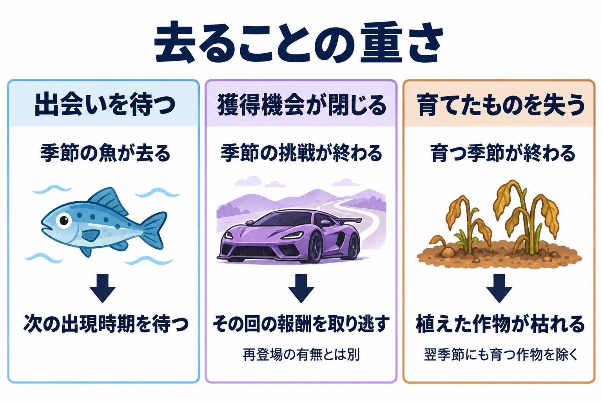

# 季節が変わると、何が戻り、何が去るか――四季の区切りと「去るもの」から、季節の遊びを決める

秋の終わり、いつもの川へ釣りに行く。昨日まで釣れていた魚が、冬を前に姿を消した。岸には雪が積もり始め、今度は冬の魚がかかる。「あの魚は、次の秋にまた探そう」。これは架空のゲームの場面である。

同じ川へ通っていても、会えるものが変わる。去った魚を覚えていれば、次の秋には川へ戻る理由ができる。季節の移り変わりは、今することと、後で楽しみにすることを分けられる。

「天気と季節から時間をつくる」第5回は、季節を扱う。[前回「その風は、何を伝えるか」](weather-season-time-wind-fog-thunder-what-it-tells.md)では、風・霧・雷が行動の手がかりを伝える設計を考えた。今回の判断軸は **「季節が変わると、何が戻り、何が去るか」** である。

***

## 季節は、何かが戻ってくる区切りである

季節の区切りを決めると、何がいつ現れるかを書けるようになる。気象庁の予報用語では、「季節を表わす用語」を次のように定義している。[[1](#ref-1)]

| 季節 | 期間の定義（原文） |
| --- | --- |
| 春 | ３月から５月までの期間。 |
| 夏 | ６月から８月までの期間。 |
| 秋 | ９月から11月までの期間。 |
| 冬 | 12月から２月までの期間。 |

これは月による区分である。一方、気象庁は「季節現象」を次のように説明している。[[2](#ref-2)]

> ある季節にだけ現れ、その季節を特徴づける生物活動や大気・地面の現象。梅雨、春一番、桜の開花、秋雨、初霜、初雪、初氷、初冠雪など。

この説明から、季節は「その季節にだけ現れるもの」が毎年戻ってくる周期としても捉えられる。月で区切りを示し、花や雨や雪で、その時期らしさを感じ取るのである。月の境界と、実際に花が咲いたり雪が降ったりする日は、別に考えられる。

ゲームでも、春という名前に何を結びつけるかで印象が変わる。花を摘む季節にしてもよいし、雪解けで開いた道を歩く季節にしてもよい。「また花を摘める」「また向こうの村へ行ける」と、プレイヤーが待つ対象を決めることが出発点になる。

季節を現実の速さで巡らせるか、縮めて回すかという基本は、[第1回「その変化は、遊びの何を変えるか」](weather-season-time-cycles-real-or-compressed.md)で扱った。今回は、その周期に載せる「戻るもの」と「去るもの」を考える。

***

## 四季は、世界共通ではない

季節の分け方は、地域の気候によって変わる。コトバンクに収録された『最新 地学事典』の「雨季」は、次のように述べている。[[3](#ref-3)]

> 熱帯地方では四季の別が明らかでないため，一年を雨季・乾季に分けることが多い。

『デジタル大辞泉』は、気温より雨量の変化で季節を捉える地域について説明する。[[3](#ref-3)]

> 熱帯・亜熱帯では気温の年変化が小さいので、季節の推移を雨量の年変化で表し、乾季に対していう。アジアのモンスーン地帯では夏、地中海方面では冬をさす。

さらに『改訂新版 世界大百科事典』には、「熱帯では，太陽が真上にくる2回の時期が雨季になるところが多い。」とある。雨季という同じ名前でも、現れる時期や巡り方には地域差がある。[[3](#ref-3)]

プランナーが意識したいのは、 **自分にとって自然な季節の区切りが、誰の生活感覚に基づいているか** である。日本で春夏秋冬に親しんできた人には、四季の巡りが企画の前提になりやすい。世界で遊ばれるゲームなら、その前提を共有しないプレイヤーもいると考えておきたい。

架空の世界なら、雨季と乾季を選ぶ余地もある。たとえば雨季には舟で村を巡り、乾季には水の引いた場所を歩く、と設計できる。これは架空の例だが、季節の名前から始めるより、暮らしや移動の何が入れ替わるかから考えやすい。

現実の行事に合わせた運営イベントと地域差は、[ライブサービスゲームの季節イベント設計](live-service-seasonal-event-cultural-calendar-design.md)で扱っている。本稿の対象は、ゲームの中で季節が巡り、出会いや行動が入れ替わる仕組みである。

***

## 戻るもの、去るもの――『あつまれ どうぶつの森』

『あつまれ どうぶつの森』では、島を作る際に北半球・南半球を選べる。任天堂の公式サポートはその選択手順を案内し、北半球と南半球では季節が逆になることも説明している。[[4](#ref-4)]

AUTOMATONのTetsuya Yoshimoto氏による2020年3月30日の記事では、「北半球は発売月である3月から春・夏・秋・冬と四季が変化していく。」「一方の南半球は秋・冬・春・夏と四季が変化する。」と紹介されている。[[5](#ref-5)] 同じ3月でも、島で迎える季節が違うのである。

生き物との出会いも季節に結びついている。任天堂の英語版公式サイトには、「You can find different critters depending on the season and time of day.」とある。季節や時間帯によって、見つかる生き物が変わるという説明である。[[6](#ref-6)]

その入れ替わりを具体的に示すのが、AUTOMATONの2020年5月28日の記事だ。同記事は、5月末で姿を隠す生き物について、次のように集計している。[[7](#ref-7)]

> 北半球では昆虫1種・魚3種の計4種類、一方の南半球では昆虫10種・魚10種の計20種もの生き物が5月末を境に姿を隠すことになる。

これは2020年5月時点の同記事の集計である。同じ月末でも、北半球では春の終わり、南半球では秋の終わりを迎えるため、去る生き物の顔ぶれが違う。

ここからは設計上の考察である。季節の生き物が去ると、その島で捕まえる機会はいったん閉じる。そして、次の出現時期が待つ対象になる。季節の虫と博物館が収集の動機になる点は、[暮らし・交流ゲームの設計](communication-game-life-sim-design-for-planners.md)でも扱った。そこに「いつ会えるか」が加わると、図鑑の空欄が、次の季節の予定にもなる。

半球の選択は、現実の暦とゲームの季節を結びつけながら、南半球のプレイヤーの季節感にも合わせられる仕組みとして読める。ただし、半球を選ぶことと、雨季・乾季を含むすべての地域の季節を再現することは、別の設計課題である。

***

## 季節は景色だけを変えない――『Forza Horizon』シリーズ

### 『Forza Horizon 4』では、報酬の期限と通れる場所が変わる

『Forza Horizon 4』を紹介するXbox Wireの記事は、「dynamic seasons create a world that is constantly evolving each week」と述べている。動的な季節によって、世界が毎週変化し続けるという意味である。季節ごとの解説は、記事中で「Turn 10 Studios’ Design Director Jon Knoles」によるものとされている。[[8](#ref-8)]

夏の節には、「keep an eye out for seasonal gameplay events, challenges, and rewards, which expire at the end of the season」とある。季節限定のイベント、挑戦、報酬には、その季節の終わりという期限がある。秋の節でも、発見して修復するクラシックカーについて「each season reveals a classic to discover and restore, but you’ll want to find it before the season changes again」と説明される。季節が変わる前に探す理由が用意されているのである。[[8](#ref-8)]

変わるのは、挑戦の一覧だけではない。冬には凍った湖を走り、普段は行けない湖の中の島などへ到達できる。春には「Previously dry or shallow riverbeds become deep, rushing streams」とある。以前は乾いていたり浅かったりした川床が、深く流れの速い川になるという意味である。同じ場所でも、季節によって移動しやすさや向く車が変わる。[[8](#ref-8)]

この設計では、冬の到来が探索範囲を広げ、冬の終わりがその機会を閉じる。季節を変えることは、「何が見えるか」に加えて「どこへ行けるか」を変えることになる。

### 『Forza Horizon 6』では、日本の季節を週替わりで巡る

日本を舞台とする『Forza Horizon 6』について、2025年9月25日のXbox Wireには、発売前の開発者の発言が載っている。同作のArt DirectorであるDon Arceta氏は、日本の季節変化が景観と遊べる世界に大きく影響し、文化的にも深い意味を持つと説明した。同作のCultural ConsultantであるKyoko Yamashita氏は、「how spring, summer, autumn, and winter subtly shift tone, activity, and sound」と語っている。春夏秋冬が、雰囲気、活動、音を少しずつ変えるという意味である。さらに日常の音として「station chimes or summer wind bells」、駅のチャイムや夏の風鈴にも触れている。[[9](#ref-9)]

遊びの周期は、2026年5月14日の公式記事に具体的に示されている。Series 1「Welcome to Japan」の日程は次のとおりである。[[10](#ref-10)]

| ゲーム内の季節 | 2026年の開催期間 |
| --- | --- |
| Summer（夏） | 5月21日〜28日 |
| Autumn（秋） | 5月28日〜6月4日 |
| Winter（冬） | 6月4日〜11日 |
| Spring（春） | 6月11日〜18日 |

同記事は「Two Seasonal reward cars are unlockable each week.」と説明する。毎週、季節報酬の車を2台アンロックできるという意味である。公式のFestival Playlist一覧でも、季節ごとのイベントと報酬が並べられている。[[10](#ref-10)][[11](#ref-11)]

この日程なら、現実の6月にゲーム内の冬が来る。『Forza Horizon』の週替わりの季節は、プレイヤーの居住地の春夏秋冬に合わせるのではなく、共通の開催日程で遊びを届ける仕組みである。『どうぶつの森』が現実の暦に季節を重ね、半球を選ばせるのとは、違う答えになる。

どちらにも、季節が去ると閉じる獲得機会がある。ただしForzaの季節報酬については、 **その開催期間が終わることと、その車が将来も二度と手に入らないことを分けて考える** 必要がある。ここで設計の対象になるのは、その回の挑戦と獲得の期限である。

広い走行空間の使い方については、[『マリオカート ワールド』と『Forza Horizon』の比較](mario-kart-world-open-world-design-vs-forza-horizon.md)も参照してほしい。季節は、その空間へ繰り返し戻る理由をつくる要素にもなる。

***

## 去ることを、損失にするか――『Stardew Valley』

『Stardew Valley』の公式Wiki「Seasons」は、「Each Season lasts 28 days.」と説明している。各季節はゲーム内の28日間続く。同ページには「Most crops, Foraging items, and fish are available only during their particular season or seasons.」ともある。作物、採集品、魚の多くは、それぞれ特定の季節にだけ得られるという意味である。祭りも各季節に2-4あると記されている。[[12](#ref-12)]

季節の境目では、畑にも変化が起きる。28日目の終わりに季節が変わると、次の季節にも育つ作物を除き、残っている作物は枯れる。翌季節にも育つ作物や、季節の影響を受けない場所は区別して考える必要がある。[[12](#ref-12)]

ここからは考察である。釣れる魚が去る場合、プレイヤーは次の機会を待てる。一方、畑の作物が枯れれば、種をまき、世話をしてきたものから収穫を得られなくなる。同じ「季節が終わる」でも、自分が費やしたお金や手間に関わるため、損失の重さが違う。

そのため、作物を選ぶときには、売値だけでなく、収穫までの日数と季節の残り日数を見比べる理由が生まれる。今から育てて間に合うものを選ぶか、次の季節のために資金を残すか。季節の終わりが、計画を立てる理由になるのである。

翌年また同じ作物を育てられることと、今年枯れた作物を取り戻せることは異なる。 **戻るのは育てる機会であり、失った収穫そのものではない** という違いが、この設計の重さを決める。

***

## ゲームへの置き換え――戻るものと去るものを組にする（考察）

ここからは、事例を企画へ置き換えるための考察である。まず、季節ごとに戻るものと去るものを並べる。「去る前の予告」には、実在作品の機能一覧ではなく、自分の企画へ取り入れる場合の案を記した。

| 作品・設計例 | 戻るもの | 去るもの | 去る前の予告 | 去ったときの損失 |
| --- | --- | --- | --- | --- |
| 『あつまれ どうぶつの森』の季節の生き物 | 次の出現時期に会える生き物 | その島で今の時期に捕まえる機会 | 案：今の時期が終わると会えなくなる生き物を示す | 次の出現時期まで待つことになる |
| 『Forza Horizon 4』の冬の湖 | 冬に湖の中の島へ渡る機会 | 冬の探索経路 | 案：冬の残り期間と、冬に行ける場所を示す | その経路で探索する機会を逃す |
| 『Forza Horizon 6』の季節報酬 | 次の季節の挑戦と報酬枠。車の顔ぶれは開催回による | その回の報酬を獲得する機会 | 案：報酬の獲得期限を示す | その回の報酬を取り逃す |
| 『Stardew Valley』の季節の作物 | 適した季節に同じ作物を育てる機会 | 次の季節に育たない、植えたままの作物 | 案：季節の残り日数と、生育できる季節を示す | 枯れた作物から収穫できず、費やした資金や手間が実らない |
| 架空の雨季・乾季の村 | 雨季の舟旅、乾季の徒歩の道 | 前の季節の移動手段や経路 | 案：水位の変化と、使えなくなる経路を示す | 目的地への行き方を変える必要がある |

季節が戻ることと、同じ報酬が戻ることも分けたい。生き物の出現周期、探索できる場所、運営が更新する報酬は、それぞれ別に「何が再登場するか」を決める対象である。

左から『あつまれ どうぶつの森』『Forza Horizon 6』『Stardew Valley』を手がかりにした設計上の整理。中央は報酬の永久消失や再登場の保証を意味せず、右は翌季節にも育つ作物を除く。

### 周期の長さと、進み方を選ぶ

現実の暦に結ぶ『どうぶつの森』型は、現実で秋を迎える感覚とゲームを重ねられる。その分、半球や地域による違いを考える必要がある。

ゲーム独自の周期なら、季節の長さを遊びに合わせて決められる。ただし、ForzaとStardewでは進み方が違う。Forzaの季節イベントは全員に共通する週替わりの日程で進む。Stardewは各ゲームの進行に応じた28日間で進むため、別々に遊ぶ人が現実の同じ日に同じ季節を迎えるとは限らない。 **季節の長さをそろえることと、切り替わる日を全員でそろえることは、別々に決める** とよい。

### 去ることの重さを選ぶ

見逃した生き物との再会を待ってほしいのか。その回の報酬を目標に挑戦してほしいのか。育てた作物を失わないよう、計画してほしいのか。何が去るかによって、季節の終わりに求める行動が変わる。

たとえば穏やかな収集ゲームなら、去るものがあっても、次に戻る時期を見通せるようにする選択がある。育成計画を楽しむゲームなら、投じた資金や手間が失われる仕組みにも役目がある。損失を採用するなら、それを避けるために必要な情報も一緒に用意したい。

予告は、まず「何が」「いつ去るか」を知らせるところから考えればよい。詳しい伝え方は第6回で扱う。本稿では、戻るものと去るものの組に、プレイヤーが失うものを書き添えておく。

***

## 企画書を見直すための点検表

- 季節ごとに、プレイヤーが「また会えた」「またできる」と感じるものを挙げられるか。
- 季節の終わりに去る生き物、経路、挑戦、作物を挙げられるか。
- 四季を使う前提は、舞台や想定するプレイヤーの生活感覚に合っているか。雨季・乾季など、別の周期も検討したか。
- 現実の暦に結ぶ場合、南北の半球や地域による季節感の違いをどう扱うか。
- ゲーム独自の周期の場合、季節の長さと、全員で同時に切り替えるかどうかを別々に決めたか。
- 去ったものは次の周期に戻るのか。その季節の再来と、同じ報酬の再登場を区別したか。
- 見逃したときに失うのは、出会う機会か、報酬を得る機会か、費やしたお金や手間か。
- 去る前に、何がいつ変わるかを知る手がかりがあるか。

季節の名前の横に、戻るものと去るものをひとつずつ書く。その組が決まれば、待つ楽しさ、今取り組む理由、次に備える必要が見えてくる。企画書へ戻るときの問いは、 **「季節が変わると、何が戻り、何が去るか」** である。

## References

1. [気象庁「時に関する用語」][1] — 気象庁、日付表記なし。「季節を表わす用語」を参照。2026年10月16日閲覧。

[1]: https://www.jma.go.jp/jma/kishou/know/yougo_hp/toki.html

2. [気象庁「季節現象」][2] — 気象庁、日付表記なし。「季節現象」の定義を参照。2026年10月16日閲覧。

[2]: https://www.jma.go.jp/jma/kishou/know/yougo_hp/kisetsu.html

3. [「雨季」各辞典の解説][3] — コトバンク、日付表記なし。『最新 地学事典』（河村武・田中博）、『デジタル大辞泉』（項目執筆者の記載なし）、『改訂新版 世界大百科事典』（前島郁雄）を参照。2026年10月16日閲覧。

[3]: https://kotobank.jp/word/%E9%9B%A8%E5%AD%A3-34341

4. [Nintendo「How to Start a New Game (Animal Crossing: New Horizons)」][4] — Nintendo UK Support、日付表記なし。島の地域・半球の選択手順と、南北の季節の反転についての説明を参照。2026年10月16日閲覧。

[4]: https://www.nintendo.com/en-gb/Support/Purchases-Subscriptions/Games/How-to-Start-a-New-Game-Animal-Crossing-New-Horizons--1747986.html

5. [Tetsuya Yoshimoto「『あつまれ どうぶつの森』北半球・南半球による違いとは。実際に確認してみた」][5] — AUTOMATON、2020年3月30日。半球ごとの季節の巡り方について、同媒体の確認記事を参照。

[5]: https://automaton-media.com/articles/newsjp/20200330-118594/

6. [Nintendo「Explore your island」][6] — Animal Crossing: New Horizons公式サイト、日付表記なし。季節・時間帯による生き物の違いについての説明を参照。2026年10月16日閲覧。

[6]: https://animalcrossing.nintendo.com/new-horizons/explore/

7. [Tetsuya Yoshimoto「『あつまれ　どうぶつの森』の北半球と南半球では「5月にいなくなる生き物の数」が大きく違う。エリアの差異がここにも」][7] — AUTOMATON、2020年5月28日。本文の生き物の数は、同記事による2020年5月時点の集計。

[7]: https://automaton-media.com/articles/newsjp/20200528-125601/

8. [Will Tuttle「How to Master the Four Seasons in Forza Horizon 4」][8] — Xbox Wire、2018年8月10日。季節ごとの解説は、記事中でTurn 10 Studios’ Design Director Jon Knolesによるものとされている。

[8]: https://news.xbox.com/en-us/2018/08/10/fh4_seasons_change_everything/

9. [Joe Skrebels「Forza Horizon 6: Answering the Big Questions About That Japan Setting」][9] — Xbox Wire、2025年9月25日。発売前のArt Director Don Arceta、Cultural Consultant Kyoko Yamashitaへの取材発言を参照。

[9]: https://news.xbox.com/en-us/2025/09/25/forza-horizon-6-japan-setting-2026/

10. [Playground Games「Experience the Mazda Furai in Forza Horizon 6’s Japan」][10] — Forza公式サイト、2026年5月14日。Series 1「Welcome to Japan」の季節日程と週ごとの季節報酬を参照。

[10]: https://forza.net/news/forza-horizon-6-series-1

11. [Forza「FH6 Festival Playlist Events and Rewards」][11] — Forza公式サイト、随時更新。季節別のイベント・報酬一覧を参照。2026年10月16日閲覧。

[11]: https://forza.net/fh6playlists

12. [Stardew Valley Wiki「Seasons」][12] — Stardew Valley公式Wiki、随時更新。28日間の季節、季節ごとの入手物、季節をまたぐ作物の条件を参照。[公式サイト](https://www.stardewvalley.net/)の「Wiki」リンク先であり、Wikiトップページにも公式Wikiと明記されている。2026年10月16日閲覧時の版では祭りは「2-4」と記載。

[12]: https://stardewvalleywiki.com/Seasons

----

この文書は、Perplexity、Claude、ChatGPT の3つのAIの支援を受けて著述されたものです。引用画像を除き、MIT License にて提供されています。
