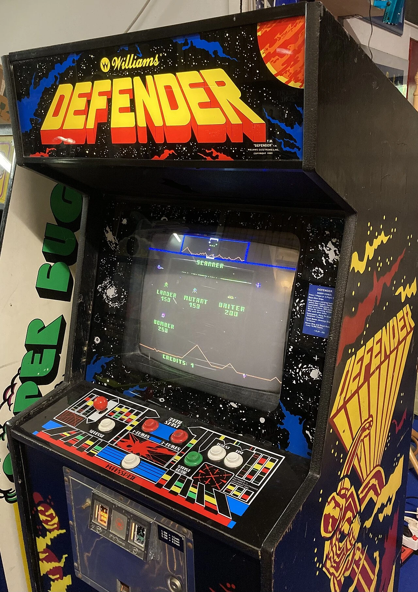
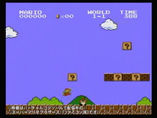
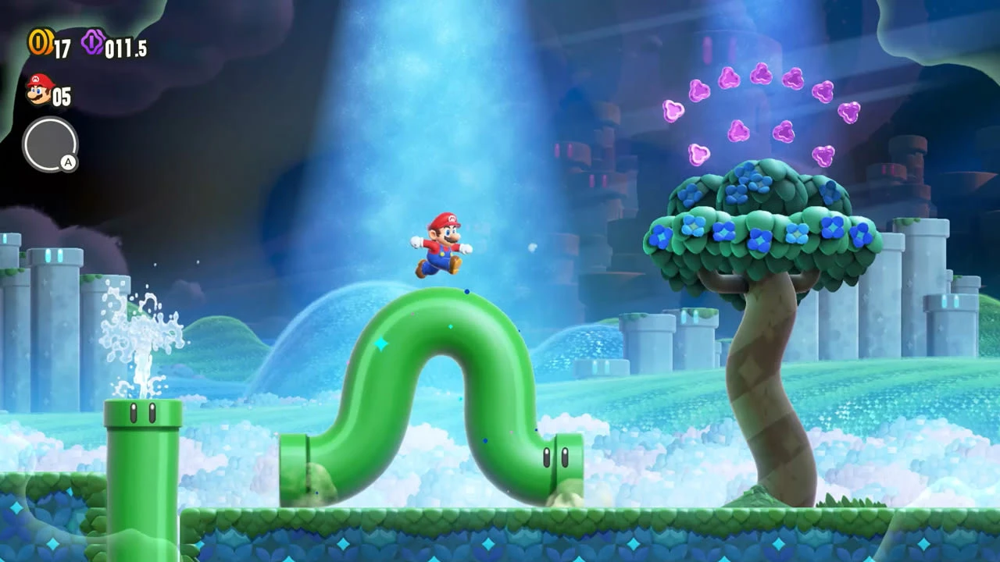

# なぜマリオは右へ進むのか？ — 横スクロールアクションゲームの変遷

マリオを遊び始めたとき、まず右へ進む。そこで何が起きるかは分からなくても、進んでいけばゴールに近づける。この見通しが、横スクロールのマリオを支えている。

任天堂の「社長が訊く スーパーマリオ25周年」で、開発者の木村氏は、スタートしたマリオが右へ進んでゴールを目指すことを、変えなかった部分として挙げている。江口氏も「右に行けばいい」という基本がどのマリオでも共通するため、何も考えずに始められる安心感があると語る。[[1](#ref-1)]

「右へ進む」は、プレイヤーとゲームのあいだにある約束なのである。その約束が育つまでには、画面の外へ世界を広げる試みがあった。そして約束が共有されると、分岐や引き返し、同じ場所の読み替えも、遊びの選択肢になった。横スクロールの歴史を、この約束をつくり、受け継ぎ、ずらす歩みとしてたどってみよう。

----

## 画面の外へ世界を広げる

### スクロールしたかった『ドンキーコング』

『ドンキーコング』を手がけた<ruby>宮本茂<rt>みやもと しげる</rt></ruby>氏は、もともとインダストリアルデザイナーだった。ゲームについても、面白さを構造から考えていたという。目的がひと目で分かること、簡単な操作でも組み合わせると難しくなること。そうした分析が、タルを避けながら上へ進む遊びにつながっていた。[[2](#ref-2)]

開発中、宮本氏は画面をスクロールさせようとした。しかし、使用する電子回路基板について「このボードはスクロールしません」と言われる。そこで4面をつなぐ構成にした。宮本氏によれば、当時は横スクロールの先駆けとなるようなゲームがようやく出てきた時代だった。[[2](#ref-2)]

このエピソードから見えるのは、画面の外へ進みたいという発想と、それを実現できる機材とが、まだ当然には結びついていなかったことである。

### 1981〜1982年のアーケードゲーム

*画像出典: [Wikimedia Commons - Williams Defender Arcade Video Game](https://commons.wikimedia.org/wiki/File:Williams_Defender_Arcade_Video_Game.jpg)（撮影: VMzB, [CC BY-SA 4.0](https://creativecommons.org/licenses/by-sa/4.0/)）*

Williamsの『Defender』は1981年の横スクロールシューティングである。The Strong National Museum of Playは、最初の画面の外に広がる世界を持つ、最初期のアーケードゲームの一つとして紹介している。[[3](#ref-3)]

同じ1981年には、コナミのシューティング『スクランブル』が登場した。燃料に限りがあるという条件も、その遊びの一部である。翌1982年には、アイレムの横スクロールのアクションシューティング『ムーンパトロール』が登場する。[[4](#ref-4)][[5](#ref-5)]

画面を一つの完結した場所として使う構成に加え、その外にも舞台が続く構成が形になっていく。マリオの横スクロールも、こうした試みの続く時代に生まれた。

----

## ワールド1-1が教える「進み方」

『スーパーマリオブラザーズ』は1985年9月13日に発売された。[[6](#ref-6)] そのワールド1-1では、進む方向と、そこで何をすればよいかが、短い体験の積み重ねで伝わってくる。

最初に出会うクリボーにそのまま触れると、マリオはやられてしまう。次には跳んで避けようとする。うまく上から踏めば、倒せることも分かる。宮本氏が「社長が訊く」で語っているのは、こうして自然に避け方や倒し方を覚える流れである。[[7](#ref-7)]

一方、キノコは触れてほしいものだ。ところが、クリボーにやられた直後のプレイヤーは、動いてくるものを警戒するかもしれない。そこでキノコの側から近づいてくるようにする。ブロックから出たキノコは右へ動き、先の土管に当たって戻ってくる。敵との遭遇に続いて、触れるとよいものとの遭遇が配置されている。[[7](#ref-7)]

Game Developerが紹介したEurogamerのインタビューでも、宮本氏はワールド1-1を、プレイヤーが段階的かつ自然に遊びを理解するためのチュートリアルとして設計したと語っている。[[8](#ref-8)]

*画像引用：任天堂「[社長が訊く『New スーパーマリオブラザーズ Wii』その1 第4回](https://www.nintendo.co.jp/wii/interview/smnj/vol1/index4.html)」掲載の映像紹介画像。© Nintendo。*

ここでは「右へ進む」と「進んだ先で学ぶ」が重なっている。プレイヤーは進行方向を毎回考え直す必要がない。その分、近づいてくるものや地形に注意を向け、操作を試せるのである。

### 『パックランド』をめぐる二つの発言

この時代の横スクロールアクションを考えるうえで、『パックランド』も外せない。同作について、パックマンの生みの親である<ruby>岩谷徹<rt>いわたに とおる</rt></ruby>氏は、アニメ「ザ・パックマン・ショー」の権利を使い、寸劇のように横スクロールで展開する方向を考えたと振り返る。営業・販売担当者には、町並みを描いた長い紙を見せて説明したという。[[9](#ref-9)]

岩谷氏は同じインタビューで、宮本氏が『スーパーマリオブラザーズ』を作る際に『パックランド』からヒントを得たと話していた、とも述べている。[[9](#ref-9)]

宮本氏本人の「社長が訊く」での説明は、自分たちの試みを中心にしている。『マリオブラザーズ』のあとに他社からジャンプするゲームがいくつか登場し、ジャンプの遊びは自分たちのアイデアだと思っていたこと、もともと大きなキャラクターが青空を背景に跳びはねる実験をしていたことを語っている。ただし、この発言では『パックランド』の名前は出していない。[[7](#ref-7)]

岩谷氏の回想は影響についての証言であり、宮本氏の説明は自身の着想と実験についての証言である。この二つから、影響の有無や範囲を一方に決めつけることはできない。

----

## なぜ「右」だったのか

任天堂の開発者の言葉がよく説明しているのは、右へ進む約束を受け継ぐ意味である。「右に行けばいい」が共通しているから、遊び始めるときに安心できる。[[1](#ref-1)] 一方、最初になぜ右を選んだのかを設計者が説明した公式資料は確認できない。

方向の感じ方を考える補助線として、Anne MaassとAurore Russoによる2003年の研究がある。イタリア語話者とアラビア語話者を比較した実験では、出来事を思い描くとき、イタリア語話者は主語を左、目的語を右に置く傾向があり、アラビア語話者では逆になった。文と絵を対応させる課題でも、それぞれの書字方向に沿った配置が読み取りを助けていた。[[10](#ref-10)]

同時に、左から右へ行為が進む絵では、言語によらず読み取りが促される傾向も見られた。研究は、脳の半球の機能分化と、文字を読む際の視線の習慣の両方が影響すると結論づけている。[[10](#ref-10)]

この研究は、向きの理解に複数の要因が関わることを示す。ただし、マリオの設計判断を調べた研究ではない。これをもって、マリオが右へ進む理由だったと結論づけることはできない。

右の起源に一つの答えを置くよりも、同じ向きで遊ぶ経験が積み重なり、次の作品にも持ち込める約束になったことに目を向けたい。

----

## 進む向きと、場所の意味を変える

### 『アトランチスの謎』：道順を分岐させる

サンソフトの『アトランチスの謎』は、1986年4月17日に発売された。全100ゾーン、隠しを含めると101ゾーンを持つが、ゾーン1から番号順にクリアする構成ではない。隠された扉や特定の行動で数十ゾーンを飛ばすことができ、一つのゾーンから複数のゾーンにつながることも多い。[[11](#ref-11)]

ここで問われるのは、目の前の障害をどう越えるかに加え、どの出口がどこへつながるかである。右へ進む距離だけでは、ゴールへの近さを測れない。道順そのものが探る対象になる。

### 『スーパーマリオUSA』：同じ場所を読み替える

『夢工場ドキドキパニック』をもとに、海外で『Super Mario Bros. 2』として発売された作品が、日本へ逆輸入された『スーパーマリオUSA』である。野菜や敵を引き抜いて投げるアクションが特徴で、日本での発売日は1992年9月14日だ。[[12](#ref-12)][[13](#ref-13)]

『スーパーマリオUSA』では、魔法の薬を投げると裏世界へのドアが現れる。裏世界ではコインや、ライフゲージのメモリを増やす「きのこ」が得られる。表世界と裏世界はつながっている。[[14](#ref-14)]

すると、先へ進むことに加えて、今いる場所で裏世界へ入るかどうかにも意味が生まれる。同じ場所でも、表と裏では得られるものが変わる。これは、進行方向を増やすこととは別の、空間の広げ方である。

### 『メトロイド』：スタート地点の左にも目を向ける

初代『メトロイド』は、1986年8月6日にディスクシステムで発売された。[[15](#ref-15)] ゲーム内では、最初のアイテムであるマルマリがスタート地点の左側に置かれている。

マリオで身につけた「まず右へ」という進み方だけでは、このアイテムに出会えない。プレイヤーの側から見ると、左へ戻って確かめることにも価値が生まれる配置である。この配置を選んだ開発者の意図については、公式資料による説明が確認できないため、ここでは画面上の事実と、そこから読める遊び方を分けておく。

### 『悪魔城ドラキュラ』：ステージから探索へ

コナミの初代『悪魔城ドラキュラ』は、1986年9月26日にディスクシステムで発売されたステージクリア型の作品である。[[16](#ref-16)] 同じシリーズでも、後の『悪魔城ドラキュラX 月下の夜想曲』では、各所を行き来する探索が重要になる。

同作の開発に携わった<ruby>五十嵐孝司<rt>いがらし こうじ</rt></ruby>氏は、制作時には『ゼルダの伝説』をより意識していたと語っている。一方、異なる場所を往復する仕組みなどは確かに『メトロイド』型の遊びであり、「メトロイドヴァニア」という呼び名にも理解を示している。[[17](#ref-17)]

この発言は、作り手が参照したものと、プレイヤーが感じ取る共通性とが、違う経路をたどることを教えてくれる。横スクロールという見た目を共有していても、目的地まで走り抜ける遊びと、場所のつながりを覚えて往復する遊びでは、方向の意味が変わる。

なお、同時代のアーケード作品には、1985年にナムコが発売した『スカイキッド』のように、2人同時協力プレイに対応した作品もあった。[[18](#ref-18)] 進む道順だけでなく、誰と一緒に遊ぶかも、この形式が広げてきた選択肢である。

----

## 2Dを選び直す——DS版から『ワンダー』へ

### 遊び始めやすい形式としての2D

2006年5月に発売されたDS版『New スーパーマリオブラザーズ』について、宮本氏は、技術を追う側から「いまさら2Dで横スクロール？」という反応があったと振り返る。それでも、横スクロールのほうが多くの人にとって遊びやすいと考え、原点に帰るマリオを作った。意識したのは、右へ進めば必ずゴールがあることだった。[[19](#ref-19)]

どちらへ向かえばよいかが分かれば、久しぶりに遊ぶ人も、まず動き出せる。ここで2Dが選ばれた理由は、遊びへの入りやすさにある。

### インディーの二つの例

2Dの可能性は、インディー作品でも育まれた。2004年に公開された『洞窟物語』の作者は、Pixelこと<ruby>天谷大輔<rt>あまや だいすけ</rt></ruby>氏である。最後の1年は、天谷氏に協力者4人を加えた5人で磨き込まれた。Game*Sparkのインタビューでは、天谷氏自身が協力者の役割を強調している。[[20](#ref-20)]

もう一つの例が『Shovel Knight』である。2013年に終了したKickstarterでは、目標の4倍以上の資金を獲得した。[[21](#ref-21)] こうした支援は、横スクロールのアクションを新たに作ろうとする企画に、期待が集まった例として読める。

DS版は遊びやすさを軸に形式を選び直し、インディーでは作り手や支援者の参加によって作品が形になった。2Dを続ける理由は、一つに限られない。

### 『ワンダー』が変えたのは、進んだ先

*画像引用: [Nintendo Official Site - Super Mario Bros. Wonder](https://www.nintendo.com/us/store/products/super-mario-bros-wonder-switch/)（公式商品ページ掲載スクリーンショット, © Nintendo。本文中の表現分析に必要な範囲で引用）*

2023年10月20日発売の『スーパーマリオブラザーズ ワンダー』では、プロデューサーを<ruby>手塚卓志<rt>てづか たかし</rt></ruby>氏、ディレクターを<ruby>毛利志朗<rt>もうり しろう</rt></ruby>氏が務めた。毛利氏は、初代のブロックやキノコが持っていた驚きについて、長く遊ばれるうちに普通のものになってきたと語る。手塚氏が掲げた課題は、今の時代にも感じられる秘密や不思議を作ることだった。[[22](#ref-22)]

その中心にあるのがワンダーフラワーである。触れると、コースの遊びが大きく変わる。[[22](#ref-22)] 本稿の視点で読むなら、右へ進むという見通しを土台に、進んだ先で起きることを変えた作品だといえる。向かう先が分かる安心感と、そこで何が起きるか分からない驚きが、同じコースに共存している。

発売から2週間で全世界430万本を突破し、任天堂は、集計を始めたWii・ニンテンドーDS以降のスーパーマリオ関連タイトルで過去最高の販売ペースと説明した。[[23](#ref-23)] 2026年3月26日には『Super Mario Bros. Wonder – Nintendo Switch 2 Edition + Meetup in Bellabel Park』も発売された。[[24](#ref-24)]

進む向きの約束を受け継ぐことと、その先を新しくすることは、両立するのである。

----

## プランナーは「進む向きの約束」をどう扱うか

ここまでの作品をもとに、企画や仕様へ持ち帰れる判断を、本稿では三つに整理する。

### 約束を画面で示す

ワールド1-1のように、最初の短い区間で、進むことと操作の学習を結びつける。[[7](#ref-7)][[8](#ref-8)] 画面のどこに主人公を置き、どちらに空間を空け、最初の障害や報酬をどう並べるか。これらを合わせて、進む向きを言葉なしで伝える設計を考えたい。

確認したいのは、説明文を読んだ人が正解を答えられるかだけではない。初めて画面を見た人が、どちらへ動き、何に気づくかである。最初の数画面は、その判断を観察するための単位にもなる。

### 約束を崩すなら、迷ったときの手がかりを書く

『メトロイド』の最初の左や、『アトランチスの謎』の分岐は、慣れた方向へ進むだけでは拾えないものを作る。そこでプランナーが仕様に書きたいのは、約束を外す理由と、迷ったときに何を頼りにできるかである。

探索の発見を楽しんでほしいのか、選んだ道の違いを楽しんでほしいのか。狙いによって、入口の見せ方や、引き返せる範囲、再訪時の目印も変わる。意外な向きへ進ませる仕掛けは、プレイヤーが判断を立て直せる手がかりと組み合わせて考えたい。

### 地域による違いを確かめる

向きの慣習はUIにも関わる。GoogleのMaterial Designは、右から左へ書く言語に対応する際、前へ進む・戻るボタンの矢印を反転させることを重視する。一方、メディアの再生ボタンや再生位置の表示は反転させず、時計も時計回りのままとする。[[25](#ref-25)]

ゲームのUIでも、矢印が場所や画面の移動を示すのか、再生など時間の流れを示すのかを分けたい。同じ三角形や矢印でも、役割が違えば扱いは変わる。UIの反転方針から、ゲーム世界の進行方向まで一律に反転させると決めるのではなく、それぞれの意味を確かめる必要がある。

### 仕様書にどう残すか

次は、右へ進むコースの途中で、左側の分岐を探索させるという **架空のゲーム仕様** の例である。既存作品の開発仕様を再現したものではない。

| 項目 | 記載例 |
| --- | --- |
| 基本の約束 | コースの主な進行方向は右。開始画面では主人公の右側に道を見せる。 |
| 最初の学習 | 安全な床で移動を試したあと、低い障害と報酬を順に置く。 |
| 約束を外す箇所と狙い | 中盤で右の道を一時的に閉じ、左の分岐を探す遊びへ切り替える。 |
| 迷ったときの手がかり | 閉じた扉から左へ続く光を置き、分岐入口に固有の目印を付ける。 |
| 引き返しと復帰 | 分岐から元の扉へ戻れる。獲得した鍵と開いた扉の状態を保持する。 |
| UIの地域対応 | メニューの「次へ・戻る」は言語に合わせて反転し、リプレイの再生ボタンは反転しない。 |
| プレイ確認 | 初見で進む方向、行き止まりで気づくもの、分岐から戻れるかを観察する。 |

向きそのものに加え、何を期待して進み、期待が外れたときにどう判断し直すかまで書く。そこまで扱うと、「右へ進む」は具体的な設計項目になる。

----

## 受け継がれる約束、その先の驚き

マリオの右には、進めばゴールがあるという見通しがある。開発者の言葉から見えてくるのは、最初の方向を選んだ理由以上に、その見通しを受け継ぐ価値である。

横スクロールは、画面の外へ舞台を広げる試みから、操作を自然に学ぶコース、分岐する道、行き来する地形、同じ場所の読み替えへと広がった。『ワンダー』は、進む向きの安心感を残し、その先で起きることを更新した。

約束があるからこそ、約束をずらす遊びも驚きになる。次の横スクロールを作るときにも、まず考えたいのは、プレイヤーが何を信じて最初の一歩を踏み出せるかなのである。

## References

1. [任天堂「社長が訊く スーパーマリオ25周年」vol.3 第5回][1] — 任天堂、2010年。木村氏・江口氏による、変わらない進行方向と安心感についての発言。

[1]: https://www.nintendo.co.jp/n10/interview/mario25th/vol3/index5.html

2. [任天堂「社長が訊く『New スーパーマリオブラザーズ Wii』」その1 第1回][2] — 任天堂、2009年。

[2]: https://www.nintendo.co.jp/wii/interview/smnj/vol1/index.html

3. [The Strong National Museum of Play「Defender」][3] — The Strong National Museum of Play、2025年殿堂入り。

[3]: https://www.museumofplay.org/games/defender/

4. [Nintendo「Arcade Archives SCRAMBLE」][4] — Nintendo、公表日記載なし。原作の発売年・メーカー・ゲーム内容を参照。

[4]: https://www.nintendo.com/us/store/products/arcade-archives-scramble-switch/

5. [Nintendo「Arcade Archives MOON PATROL」][5] — Nintendo、公表日記載なし。原作の発売年・メーカー・ジャンルを参照。

[5]: https://www.nintendo.com/es-mx/store/products/arcade-archives-moon-patrol-switch/

6. [任天堂「VC スーパーマリオブラザーズ」][6] — 任天堂、公表日記載なし。

[6]: https://www.nintendo.co.jp/wii/vc/vc_smb/vc_smb_01.html

7. [任天堂「社長が訊く『New スーパーマリオブラザーズ Wii』」その1 第4回][7] — 任天堂、2009年。

[7]: https://www.nintendo.co.jp/wii/interview/smnj/vol1/index4.html

8. [Chris Kerr「How Miyamoto built Super Mario Bros.' legendary World 1-1」][8] — Game Developer、2015年9月8日。Eurogamerによる宮本氏へのインタビューを紹介した記事。

[8]: https://www.gamedeveloper.com/design/how-miyamoto-built-i-super-mario-bros-i-legendary-world-1-1

9. [GAME Watch「映画『ピクセル』BD&DVD発売記念！ 岩谷徹氏インタビュー」][9] — GAME Watch、2016年1月18日。

[9]: https://game.watch.impress.co.jp/docs/news/739414.html

10. [Anne Maass, Aurore Russo「Directional Bias in the Mental Representation of Spatial Events」][10] — Psychological Science、2003年7月。Psychological Science 14(4)。公開要旨を参照。

[10]: https://www.psychologicalscience.org/journals/psychological-science/1467-9280.14421/

11. [ウワーマン「『アトランチスの謎』40周年。当時としては圧倒的なボリューム感と探索の自由度の高さが現代で再評価!? 高難度かつ理不尽なサンソフトの伝説的タイトル【今日は何の日？】」][11] — ファミ通.com、2026年4月17日。

[11]: https://www.famitsu.com/article/202604/71709

12. [任天堂「スーパーマリオＵＳＡ」][12] — 任天堂、公表日記載なし。作品の成り立ちとアクションを参照。発売日は文献13による。

[12]: https://www.nintendo.co.jp/ngc/sms/history/smu/index.html

13. [インサイド「Wii Uバーチャルコンソール3月19日配信タイトル ― 『スーパーマリオUSA』『熱血高校ドッジボール部 サッカー編』『魔城伝説』の3本」][13] — インサイド、2014年3月12日。

[13]: https://www.inside-games.jp/article/2014/03/12/75089.html

14. [任天堂「VC スーパーマリオUSA」][14] — 任天堂、公表日記載なし。

[14]: https://www.nintendo.co.jp/wii/vc/vc_usa/vc_usa_01.html

15. [任天堂「メトロイド ドレッド レポート Vol.04 シリーズ35年のストーリーを紐解く」][15] — 任天堂、2021年。初代の発売日・対応機種を参照。

[15]: https://www.nintendo.com/jp/switch/ayl8a/report/vol4/index.html

16. [ファミ通「初代『悪魔城ドラキュラ』がFCディスクシステムで発売された日。ムチを振るうアクションが爽快で魅力的なゴシックホラー2Dアクション【今日は何の日？】」][16] — ファミ通.com、2020年9月26日。

[16]: https://www.famitsu.com/news/202009/26206478.html

17. [Matt Miller「Igarashi Talks Metroidvania, Discusses New Project」][17] — Game Informer、2014年3月19日。USgamerなどのインタビューを紹介した記事。英語の発言の大意は本稿による。

[17]: https://gameinformer.com/b/news/archive/2014/03/19/igarashi-talks-metroidvania.aspx

18. [Nintendo「Arcade Archives SKY KID」][18] — Nintendo、公表日記載なし。原作の発売年・メーカー・協力プレイを参照。

[18]: https://www.nintendo.com/us/store/products/arcade-archives-sky-kid-switch/

19. [任天堂「社長が訊く『New スーパーマリオブラザーズ Wii』」その1 第5回][19] — 任天堂、2009年。

[19]: https://www.nintendo.co.jp/wii/interview/smnj/vol1/index5.html

20. [今井晋「【Indie Japan Rising】生きてる限り、何かを作りたい。『洞窟物語』から『ケロブラスター』に至る天谷大輔氏インタビュー」][20] — Game*Spark、2014年5月24日。

[20]: https://www.gamespark.jp/article/2014/05/24/48753.html

21. [Game*Spark「ショベル騎士アクションアドベンチャー『Shovel Knight』のKickstarterが終了、獲得資金は目標の4倍以上」][21] — Game*Spark、2013年4月15日。

[21]: https://www.gamespark.jp/article/2013/04/15/40188.html

22. [任天堂「開発者に訊きました スーパーマリオブラザーズ ワンダー」][22] — 任天堂、2023年10月18日。

[22]: https://www.nintendo.com/jp/interview/aqmxa/index.html

23. [Kosuke Takenaka「『スーパーマリオブラザーズ ワンダー』なんと発売2週間で全世界430万本突破。『マリオ』シリーズ過去最高の超ペース」][23] — AUTOMATON、2023年11月8日。任天堂の同日付決算説明資料を紹介。販売ペースの比較対象はWii・ニンテンドーDS以降。

[23]: https://automaton-media.com/articles/newsjp/20231108-271292/

24. [Sal Romano「Super Mario Bros. Wonder – Nintendo Switch 2 Edition + Meetup in Bellabel Park launches March 26」][24] — Gematsu、2026年1月22日。

[24]: https://www.gematsu.com/2026/01/super-mario-bros-wonder-nintendo-switch-2-edition-meetup-in-bellabel-park-launches-march-26

25. [Google「Material Design: Bidirectionality」][25] — Google、公表日記載なし。

[25]: https://m1.material.io/usability/bidirectionality.html

----

この文書は、Perplexity、Claude、ChatGPT の3つのAIの支援を受けて著述されたものです。引用画像を除き、MIT License にて提供されています。
