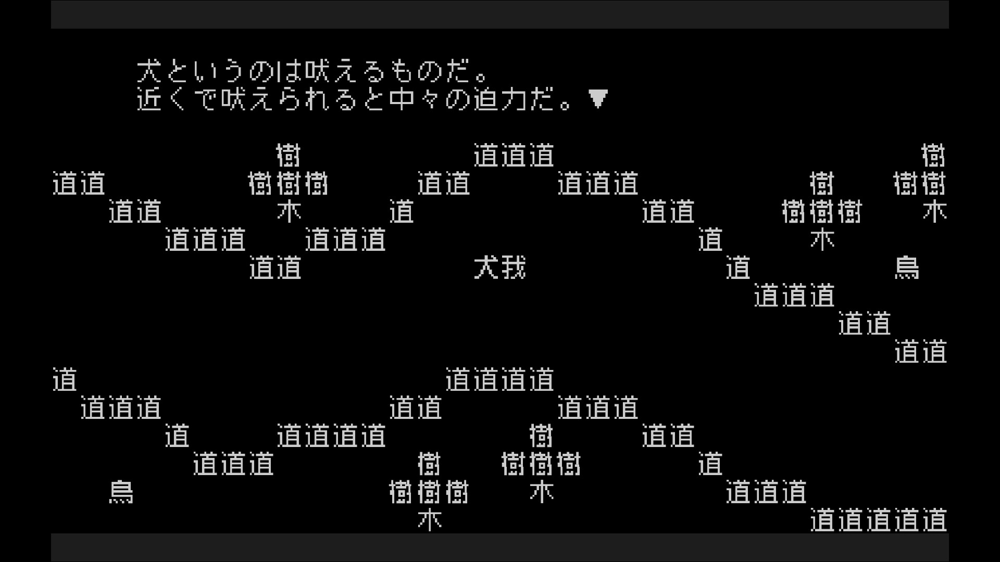
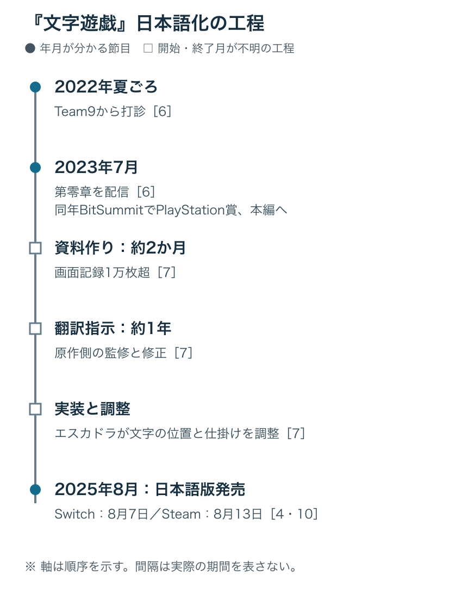

# 文字で遊ぶゲームを、別の文字で作り直す――『文字遊戯』日本語化の3年

> 本稿では、媒体で紹介された文字の動きや仕掛けに触れます。謎の解き方の紹介は「銅」と「鉄槌」などの例にとどめ、物語の後半や結末には触れません。

## 1. 日本語化まで評価された、最後の受賞作

2026年9月15日、日本ゲーム大賞2026のゲームデザイナーズ大賞に、Team9の『文字遊戯』が選ばれた。同賞は今回が最後である。その受賞理由は、遊びの独創性とともに、日本語化にも目を向けていた。[[1](#ref-1)]

> さらに驚くべきことは、日本語でしか成立しない内容に見えて、繁体字中国語からのローカライズ作品です。[[1](#ref-1)]

授賞式には、Team9の総合プロデューサーであるチャン・ウェイウェイ氏と、本作の日本語化を担当したフライハイワークスの黄政凱氏が登壇した。[[2](#ref-2)] 賞の評価の歴史は、[ゲームデザイナーズ大賞の評価と継承を扱った記事](game-designers-award-evaluation-and-succession.md)でたどっている。本稿では、この受賞作が日本語で遊べるようになるまでの工程を追う。

『文字遊戯』では、文字の意味も形も配置も、遊びの部品になる。別の言語に移すには、 **文章と、その文章で成立する遊びを一緒に作り直す** 必要があった。その仕事は、翻訳用の資料作りから、原作側との合意、実装の改修、商品としての出し方まで広がったのである。

***

## 2. 文字を読むことが、世界を動かすことになる

原作は、台湾のTeam9が2022年に繁体字中国語で発売したアドベンチャーゲームだ。公式サイトの開発年表にも、2022年1月の発売が記されている。[[3](#ref-3)]

登場人物、背景、物まで、すべてが文字で作られている。壁は「壁」、川は川を表す漢字で描かれ、「門」の字は通れる門として機能する。主人公は「我」。プレイヤーは文字を削ったり、引っ張ったり、くっつけたり、分けたりして、意味や文脈を書き換えて進む。[[4](#ref-4)] 操作は魔道具を手に入れるごとに増えていく。[[5](#ref-5)]

文字が登場人物や地形そのものとして配置されている。画像出典（引用）：[『文字遊戯（日本語版）』Steamストアページ](https://store.steampowered.com/app/2343610/)。©Team9 ©Flyhigh Works。画面全体を引用。

Game*Sparkのプレイレポートが紹介した例では、「銅」がある状態で「鉄槌」に触れると「銅片」に変わる。また、錠前を回すと「回」の字そのものが回り、酒を飲むと「酒」の一画目が下がって、中身が減ったように見える。文字が何を意味するかを読み取る楽しさと、文字自体が物として振る舞う面白さが重なっている。[[5](#ref-5)]

こうした作りでは、台詞の一文字にも仕掛けが関わる。訳文として自然であることに加え、操作したときに遊びが成立することまで求められる。

***

## 3. 「翻訳不可能」と呼ばれた理由

### 一文字を消すという条件を、日本語でも守る

日本語版のローカライズと翻訳を担った黄政凱氏は、フライハイワークスの代表取締役である。過去には『逆転裁判123 成歩堂セレクション』や『シュタインズ・ゲート』の中国語版も担当している。[[6](#ref-6)]

黄氏が難所として挙げたのが、原作で「不」を消して意味を反転させる仕掛けだった。中国語では、否定を表す「不」を取り除いても、そのまま文章として成立する場合が多い。日本語では「おいしくない」などから一文字を削っても、同じようには意味を反転できない。「不・無・非・未」という接頭辞を使う方法も、取り除いた後に自然な日本語が残らないことが多かったという。[[6](#ref-6)]

しかも、原作側は原作の味わいを保つため、2文字以上の削除を認めなかった。日本語の否定表現に合わせて削る文字数を増やす方法は採れず、こうした種類の謎はすべて考え直した。[[6](#ref-6)] 守るべき条件が「文章の意味」だけでなく、「一文字を操作して変化を起こす感触」にもあったわけだ。

### 文字数の中に、意味と仕掛けを収める

黄氏によれば、同じ意味を伝えるために日本語では文字数が増えやすく、本作の文字数制限は厳しかった。とりわけ、主人公が複数の四字熟語に囲まれる場面では、限られた文字数で文章を用意しながら、仕掛けの条件も満たす必要があった。[[6](#ref-6)]

黄氏は作業の感覚を「『地獄のもじぴったん』を延々とやっている感じ」と表現した。解ける保証のある問題に挑むのと違い、日本語で成立する答えがあるかどうかから探さなければならない。案が見つからないものはいったん寝かせ、どうしても解決できない場合は原作側と相談して、問題そのものを調整した。[[6](#ref-6)]

ここには、翻訳する人自身が謎を設計する難しさがある。自然な文章、文字数、操作のルールを同時に満たす案を作り、それが原作の狙いに沿うかを確かめる必要があった。

***

## 4. 打診から発売まで――作り直すための工程

### まず『第零章』で、日本語の遊びとして届くかを試す

始まりは2022年夏ごろ、Team9から寄せられたローカライズと販売の打診だった。黄氏は本編を完成させるには少なくとも2年かかると見込み、まず『文字遊戯 第零章』を日本語化し、反応を見て判断することを提案した。[[6](#ref-6)]

『第零章』は2023年7月に配信された。同年のBitSummitへの出展で好評を得て、PlayStation賞も受賞した。この反応を受け、本編の日本語化を進めることになった。[[6](#ref-6)] 小さな範囲を実際に遊べる形にすることが、日本語でも面白さが伝わるかを見極める試金石になった。

### 全編を見渡せる資料を、画面から作る

原作はローカライズを想定しておらず、仕様書もなかった。黄氏の言葉では「マイナスからのスタート」である。まず原作を隅々まで遊んだ動画を用意し、すべての台詞をスクリーンショットとして記録した。その数は1万枚を超え、翻訳指示を書き込むための資料を整えるだけで約2か月かかった。[[7](#ref-7)]

画面には、文章の前後関係に加え、文字の配置も残る。文字が操作対象になる本作では、どの場面で、どの字が、何のために置かれているかまで見渡せることが、その後の検討の土台になったと考えられる。

### 指示を書き、原作側の監修を経てから実装する

資料が整うと、そこへ約1年かけて翻訳指示を書き込んだ。原作側の監修と修正指示を受け、内容を整えてから実装に入った。原作の意図をどう受け取り、日本語ではどのような謎へ変えたのかを、先に理解してもらうためだった。実装後に変更が差し戻されると双方の負担が大きくなるため、黄氏はこの順序を重視した。[[7](#ref-7)]

さらに、資料には解き方を変更した経緯も書き残した。採用しなかった案も消さず、打ち消し線を引いて残している。複数の可能性を検討した末に、その案へ至ったことを原作側に伝えるためである。[[7](#ref-7)]

完成した訳文だけを渡す場合、原作から離れた理由は読み取りにくい。検討の履歴があれば、変更の必要性と、最後まで守ろうとした要素を共有しやすくなる。

### 難しさの基準も、原作側とそろえる

原作側からは、彼らの考える「パズル」と「ナゾ」の違いも説明された。「パズル」は難問を解いた自分に達成感を覚えるもの、「ナゾ」は巧妙な問題を考えた人に感心するもの、という区別である。これは原作チームが本作の狙いを伝えるための説明だ。[[7](#ref-7)]

『文字遊戯』が目指すのは後者であり、問題に詰まって先へ進めなくなることは避けたい。そのため日本語版でも難しすぎないように調整し、ポーズ画面の「瞑想」では段階的にヒントを得られるようになっている。[[7](#ref-7)]

謎の答えを用意するだけでなく、どれくらい悩み、どんな気持ちで先へ進んでほしいかも、共有すべき設計の一部だった。

### 文字をオブジェクトとして、一つずつ調整する

プログラムとグラフィックを担当したのは、エスカドラである。原作のプログラムも多言語対応を想定しておらず、広範な改修が必要になった。[[7](#ref-7)]

台詞の文字は、単純なテキストデータではなく、操作や反応の対象となるオブジェクトとして扱われていた。翻訳すると、仕掛けに反応する字の位置も変わる。そのため、個々の謎に合わせて調整しなければならなかった。黄氏によれば、エスカドラからも作業量の膨大さを聞いていたという。[[7](#ref-7)]

日本語版は、メニューで言語を切り替える構成ではなく、独立した『文字遊戯（日本語版）』として作られた。こうした実装上の事情も、その理由の一つである。[[7](#ref-7)] プロジェクトは約3年に及び、2024年の発売予定から約1年を経て、2025年8月の発売に至った。[[6](#ref-6)][[4](#ref-4)]

***

## 5. 独立した日本語版を、商品として届ける

Nintendo Switch版は、2025年8月7日にフライハイワークスから配信された。[[4](#ref-4)] Steam版も同日の配信を予定していたが、審査が完了せず、発売が遅れた。フライハイワークスが公開した説明によると、Steam側からは、同じ作品のローカライズ版なら別タイトルではなく、原作のDLCとして発売するなどの対応を求められたという。[[8](#ref-8)]

これに対しフライハイワークスは、言語の特徴を使った本作では単純な翻訳データの差し替えでは済まず、文章も仕掛けも変更していること、発売元も異なること、ストアページ公開時には指摘がなかったことを説明し、再審査を求めた。その後、審査を通過した。[[8](#ref-8)][[9](#ref-9)] Steam版は8月13日に配信され、ストアには開発元としてTeam9とESQUADRA,inc.、発売元としてFlyhigh Worksが記載されている。[[10](#ref-10)]

ファミ通も、日本語版は翻訳と仕掛けに多数の変更を加え、内部データから大幅に改修した作品であり、原作とは独立したストアページを持つと伝えている。[[11](#ref-11)]

遊びを別の言語で作り直す仕事は、完成したデータをどう販売するかという段階にも続いていたのである。

***

## 6. プランナーが持ち帰れること

この事例を企画や制作の判断へつなげるなら、五つの点が挙げられる。

第一に、 **翻訳の前提となる資料を、作業として見積もること** だ。仕様書がない作品では、場面を収集して全体を見渡せるようにするところから始まる。台詞の量だけを数えても、準備に必要な仕事は捉えきれない。

第二に、作り直せる範囲を原作側と合意し、その理由を残すことである。本作では、一文字を削る感触を守るために謎そのものを変えた。何を維持し、何を変更してよいかを先に決めれば、案を評価する基準になる。採用しなかった案も、合意の根拠を伝える資料になるだろう。

第三に、難しさの狙いも共有することである。長く考えることを楽しませたいのか、ひらめきを得ながら先へ進んでほしいのかによって、調整は変わる。段階的なヒントも、その狙いを実現する仕組みに含まれる。

第四に、文字の扱い方や多言語対応の設計が、後の作業量と費用を左右することである。文字をテキストとして表示するのか、動かせる物として置くのか。訳文の長さや操作対象の位置が変わったとき、どこまで自動で対応できるのか。他言語を最初から視野に入れるかどうかは、企画段階から検討できる。

第五に、独立した版として出すなら、ストア上でどう扱われるかも事前に確かめることである。制作側が想定する商品の区分と、審査での扱いを早めにすり合わせることは、発売準備の一部になる。

ローカライズ全体の工程は、[ゲームローカライズの工程と実践](game-localization-guide.md)で整理している。『文字遊戯』の約3年が具体的に示したのは、 **別の言語でも同じ面白さへたどり着けるよう、資料、合意、実装、発売の準備をつなぐ仕事** である。文字が遊びそのものである作品では、そのつながりが、日本語で遊べる一本を支えていた。

## References

1. [CESA「日本ゲーム大賞2026 年間作品部門 発表授賞式」][1] — PR TIMES、2026年9月15日。受賞作、同賞の終了、桜井政博氏による受賞理由。

[1]: https://prtimes.jp/main/html/rd/p/000000160.000013057.html

2. [屋敷悠太「『文字遊戯』が日本ゲーム大賞2026『ゲームデザイナーズ大賞』受賞！ 桜井氏登壇『ゲームデザイナーズ大賞は今年で最後』」][2] — GAME Watch、2026年9月15日。授賞式の登壇者。

[2]: https://game.watch.impress.co.jp/docs/news/2141168.html

3. [Team9「《文字遊戲》官方網站」][3] — Team9、公開日記載なし。開発チームの紹介と開発年表。2026年11月6日参照。

[3]: https://wordgame.cc/

4. [Keiichi Yokoyama「“全部文字”の世界冒険ゲーム『文字遊戯』日本語版、本日サプライズ配信。日本語化困難と思われた好評作がついに」][4] — AUTOMATON、2025年8月7日。遊びの概要とNintendo Switch版の配信。

[4]: https://automaton-media.com/articles/newsjp/20250807-352617/

5. [各務都心「これをよくぞ翻訳した！あまりに挑戦的なRPG風アドベンチャー『文字遊戯』プレイレポ―勇者よ、文字だけで構成されたこの世界を救うのだ」][5] — Game*Spark、2025年8月12日。「銅」「回」「酒」の例と魔道具による操作の追加。

[5]: https://www.gamespark.jp/article/2025/08/12/155953.html

6. [なからい（取材・文）、うきゅう（編集）「『文字遊戯』翻訳者インタビュー」2ページ目][6] — 電ファミニコゲーマー、2025年8月13日。黄政凱氏へのメールインタビュー。日本語化の打診、第零章、文字数と削除の制約、開発期間。同インタビューはSponsored（PR）表記の記事。

[6]: https://news.denfaminicogamer.jp/interview/250813w/2

7. [なからい（取材・文）、うきゅう（編集）「『文字遊戯』翻訳者インタビュー」1ページ目][7] — 電ファミニコゲーマー、2025年8月13日。資料整備、翻訳指示、原作側との合意、難しさの基準、実装体制と文字の扱い。全3ページのうち、3ページ目はルビと固有名詞の説明。

[7]: https://news.denfaminicogamer.jp/interview/250813w

8. [フライハイワークス・黄政凱「『文字遊戯(日本語版)』STEAM版に関しまして」][8] — フライハイワークス、2025年8月7日公開、8月13日追記。発売元による審査経緯の説明。Steam側の指摘は同社が公表した内容に基づく。

[8]: https://docs.google.com/document/d/e/2PACX-1vQF0AbOYv2hKjOsItq9prTYRnUvqkydskzn1cTKwhOReuLCatMuUYdePsaueAXYj3cESoMA2JYbH5so/pub

9. [Haru Takitoh「Steam版だけ延期になった全部文字世界冒険ゲーム『文字遊戯』日本語版、無事に“再審査”通過。本日夕方配信へ」][9] — AUTOMATON、2025年8月13日。再審査の経緯と配信予定の発表。

[9]: https://automaton-media.com/articles/newsjp/word-game-20250813-353184/

10. [Team9・ESQUADRA,inc.・Flyhigh Works「文字遊戯(日本語版)」][10] — Steam、2025年8月13日発売。発売日、開発元、発売元。2026年11月6日参照。

[10]: https://store.steampowered.com/app/2343610/

11. [ファミ通.com「『文字遊戯(日本語版)』Steam版が本日（8/13）夕方までに配信決定。Steam側の審査が長期間滞り、Switch版から6日遅れての発売に」][11] — ファミ通.com、2025年8月13日。内部データの改修と独立したストアページ。

[11]: https://www.famitsu.com/article/202508/49644

----

この文書は、Perplexity、Claude、ChatGPT の3つのAIの支援を受けて著述されたものです。引用画像を除き、MIT License にて提供されています。
